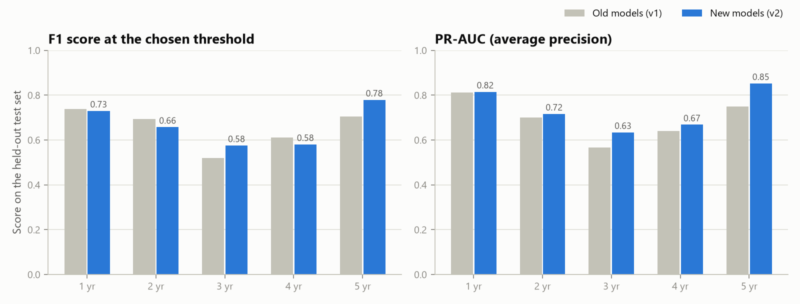

# 📊 Bankruptcy Risk Predictor

Predict whether a company will go bankrupt **1, 2, 3, 4 or 5 years ahead** from its financial ratios.
The project uses LightGBM models trained on 43,405 financial statements of Polish companies, explains every
prediction, and includes an interactive Streamlit app.

📘 **New to the project? Read [docs/How_It_Works.pdf](docs/How_It_Works.pdf)**, a plain-English guide to the data,
the model, the scoring and the app.

---

## ✨ What it does

* **Five models, one per horizon.** Each one predicts bankruptcy a fixed number of years ahead.
* **20 key financial ratios per model**, chosen automatically from the 64 available.
* **Honest probabilities.** Scores are calibrated, so "30%" means about 30 in 100 similar companies went bankrupt.
* **A tuned decision threshold per horizon** that balances catching bankruptcies against false alarms (best F1).
* **Explanations.** Every prediction shows which ratios pushed the risk up or down (SHAP values).
* **Streamlit app** with single-company scoring, ready-made example companies, CSV batch scoring and a model guide.

## 🚀 Quick start

```bash
git clone https://github.com/cooldudeayush/Bankruptcy-model-latest-.git
cd Bankruptcy-model-latest-
pip install -r requirements.txt
streamlit run app.py
```

Python 3.11 or newer is required. The app opens at http://localhost:8501.

## 📈 Results

Scores on the 15% of companies held back for testing. These were never used for training, feature selection,
tuning or picking the threshold. Brackets show 95% bootstrap intervals.

| Years ahead | Threshold | Recall | Precision | F1 | ROC-AUC | PR-AUC |
|---|---|---|---|---|---|---|
| 1 | 0.33 | 0.74 | 0.72 | 0.730 [0.64–0.81] | 0.959 [0.93–0.98] | 0.815 [0.73–0.89] |
| 2 | 0.29 | 0.64 | 0.68 | 0.658 [0.56–0.74] | 0.926 [0.89–0.96] | 0.717 [0.63–0.80] |
| 3 | 0.27 | 0.54 | 0.62 | 0.576 [0.47–0.67] | 0.927 [0.89–0.96] | 0.634 [0.53–0.74] |
| 4 | 0.24 | 0.60 | 0.56 | 0.581 [0.47–0.68] | 0.926 [0.89–0.96] | 0.668 [0.55–0.77] |
| 5 | 0.35 | 0.73 | 0.83 | 0.779 [0.65–0.87] | 0.984 [0.97–0.99] | 0.852 [0.75–0.93] |

*Recall* = share of bankrupt companies the model caught. *Precision* = share of alarms that were right.
Only 4–7% of companies went bankrupt, so accuracy is not a useful score here: a model that always says
"safe" would already be 95% accurate.

### Compared with the original models (v1), on the same test companies

| | v1 average | v2 average |
|---|---|---|
| PR-AUC | 0.694 | **0.737** (better on all 5 horizons) |
| ROC-AUC | 0.930 | **0.944** (better or equal on all 5 horizons) |
| F1 | 0.654 | **0.665** |



Full details: [reports/metrics.md](reports/metrics.md).

## 🔧 What changed in v2

| Issue in v1 | Fix in v2 |
|---|---|
| Horizons were reversed: `1year.arff` was labelled "1 year ahead", but according to UCI it holds the status **after 5 years** | Horizons follow the UCI definition: 1 year ahead = `5year.arff` … 5 years ahead = `1year.arff` |
| Top features were picked using all data, test rows included (data leakage) | Features are picked inside cross-validation on training data only |
| Hand-set hyper-parameters (2000 trees, 128 leaves); `subsample` had no effect because `subsample_freq` was never set | Optuna searches 40 settings per horizon using 5-fold CV and early stopping |
| Threshold picked on one small 15% validation split, so unstable (0.16–0.60) | Threshold picked on out-of-fold predictions over the full training set |
| Probabilities were distorted by class weighting | Platt calibration turns scores into honest probabilities |
| Median imputation hid the fact that missing values carry information | LightGBM handles missing values natively; the app lets you choose "unknown" (typical value) or "not reported" |
| App ignored the tuned thresholds (always used 0.5) | App uses each horizon's threshold and shows the reasons for each prediction |
| 82 MB of pickled scikit-learn pipelines, tied to one scikit-learn version | 5 MB of LightGBM text models, readable with any LightGBM 4.x |
| Notebook only | Reproducible package, training CLI, tests, Dockerfile, deployment guide |

## 🧠 How it works (short version)

```
financial ratios ─► pick the horizon's model ─► LightGBM (hundreds of small trees) ─► risk score
     ─► calibration ─► probability ─► compare with threshold ─► verdict + top reasons
```

Training pipeline (`python -m bankruptcy.train`), run for each horizon:

1. **Split:** 85% train / 15% test, stratified. Same seed as v1, so the test rows are identical.
2. **Select features:** rank all 64 ratios by average LightGBM gain across 5 CV folds, then keep the top 20.
   (In experiments, 20 ratios were as accurate as all 64.)
3. **Tune:** Optuna, 40 trials, objective = cross-validated average precision.
4. **Calibrate and set the threshold:** 5-fold × 3 repeats of out-of-fold predictions → Platt scaling → F1-optimal threshold.
5. **Final fit** on the full training part, then **score the test part once**.

## 📁 Project structure

```
├── app.py                    # Streamlit app
├── bankruptcy/               # Python package
│   ├── config.py             # paths, horizons, settings
│   ├── data.py               # load .arff files, train/test split
│   ├── features.py           # names and plain-English meanings of the 64 ratios
│   ├── train.py              # training pipeline (python -m bankruptcy.train)
│   ├── predict.py            # BankruptcyPredictor: probability, verdict, explanation
│   └── report.py             # metrics tables and charts
├── data/raw/                 # 1year.arff … 5year.arff (UCI dataset)
├── models/                   # model_1y.txt … model_5y.txt + metadata.json
├── reports/                  # metrics.md, metrics.json, figures/
├── docs/
│   ├── How_It_Works.pdf      # plain-English guide
│   ├── make_explainer_pdf.py # rebuilds the guide from the current models
│   └── DEPLOYMENT.md         # how to put the app online
├── tests/                    # pytest: predictor + app
├── Dockerfile, packages.txt  # deployment
├── requirements.txt          # app dependencies
└── requirements-train.txt    # + training, tests and PDF dependencies
```

## 🐍 Use the models in Python

```python
from bankruptcy.predict import BankruptcyPredictor

predictor = BankruptcyPredictor()
company = {"Attr27": 0.4, "Attr34": 0.9, "Attr21": 0.8}   # any ratios you have; the rest count as unknown

predictor.predict(1, company)      # probability, threshold, prediction, risk level (1 year ahead)
predictor.explain(1, company)      # each ratio's push on the risk score
predictor.features(1)              # the 20 ratios the 1-year model uses
```

`predict` also accepts a DataFrame with one row per company.

**Missing values:** by default, missing ratios are passed to the model as missing. In this dataset a value
missing from the accounts is itself a warning sign. For example, 96% of 1-year-ahead companies with no
sales-growth figure went bankrupt. If a value is simply unknown to you, pass `fill_missing=True` so the
model uses a typical (median) value instead. The app does this by default.

## 🔁 Retrain and test

```bash
pip install -r requirements-train.txt
python -m bankruptcy.train          # ~15-20 min: writes models/ and reports/
pytest                              # 11 tests: predictor + Streamlit app
python docs/make_explainer_pdf.py   # refresh the PDF guide with the new numbers
```

## 🌍 Deployment

The app can be deployed for free on Streamlit Community Cloud in about 5 minutes. Docker, Hugging Face Spaces,
Render and Cloud Run options are also covered. See **[docs/DEPLOYMENT.md](docs/DEPLOYMENT.md)**.

## 📊 Dataset

[Polish Companies Bankruptcy](https://archive.ics.uci.edu/dataset/365/polish+companies+bankruptcy+data), UCI Machine
Learning Repository (Tomczak, 2016), from the EMIS database. Bankrupt companies were analysed over 2000–2012 and
operating companies over 2007–2013. Each row is one company's financial statement: 64 ratios plus a bankrupt / not
bankrupt label.

| Years ahead | File | Companies | Bankrupt |
|---|---|---|---|
| 1 | 5year.arff | 5,910 | 410 |
| 2 | 4year.arff | 9,792 | 515 |
| 3 | 3year.arff | 10,503 | 495 |
| 4 | 2year.arff | 10,173 | 400 |
| 5 | 1year.arff | 7,027 | 271 |

> Note: the same companies can appear in several files (different years), so the files are modelled separately
> rather than pooled. Pooling them made cross-validation scores look much better than they really are.

> This tool is for education and research. It is not financial advice.

## 📬 Contact

Feel free to reach out to Subhojit Sapui, Ayush Ranjan, or Aditi Pandey regarding this project.
