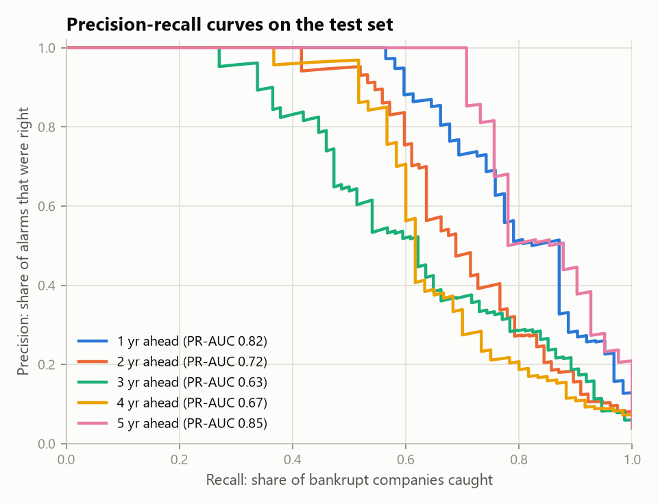
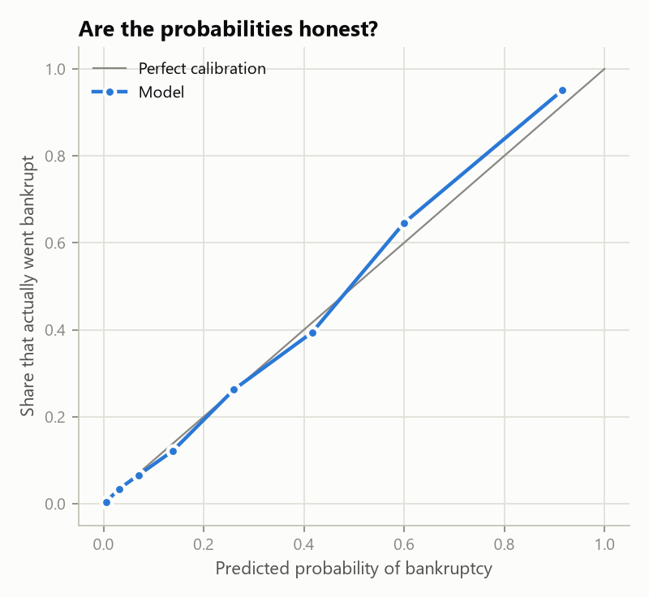

# Model performance (v2)

Trained 2026-10-17 · LightGBM gradient-boosted decision trees · LightGBM 4.7.0

Scores on the held-out 15% test set (never used for training, feature selection, tuning or thresholds). 95% bootstrap intervals in brackets.

| Years ahead | Data file | Features | Threshold | F1 | Precision | Recall | ROC-AUC | PR-AUC |
|---|---|---|---|---|---|---|---|---|
| 1 | 5year.arff | 20 | 0.33 | 0.730 [0.64–0.81] | 0.719 | 0.742 | 0.959 [0.93–0.98] | 0.815 [0.73–0.89] |
| 2 | 4year.arff | 20 | 0.29 | 0.658 [0.56–0.74] | 0.681 | 0.636 | 0.926 [0.89–0.96] | 0.717 [0.63–0.80] |
| 3 | 3year.arff | 20 | 0.27 | 0.576 [0.47–0.67] | 0.615 | 0.541 | 0.927 [0.89–0.96] | 0.634 [0.53–0.74] |
| 4 | 2year.arff | 20 | 0.24 | 0.581 [0.47–0.68] | 0.562 | 0.600 | 0.926 [0.89–0.96] | 0.668 [0.55–0.77] |
| 5 | 1year.arff | 20 | 0.35 | 0.779 [0.65–0.87] | 0.833 | 0.732 | 0.984 [0.97–0.99] | 0.852 [0.75–0.93] |

## Compared with the v1 models (same test rows)

| Years ahead | v1 F1 | v2 F1 | v1 PR-AUC | v2 PR-AUC | v1 ROC-AUC | v2 ROC-AUC |
|---|---|---|---|---|---|---|
| 1 | 0.739 | 0.730 | 0.812 | 0.815 | 0.959 | 0.959 |
| 2 | 0.694 | 0.658 | 0.700 | 0.717 | 0.914 | 0.926 |
| 3 | 0.519 | 0.576 | 0.567 | 0.634 | 0.916 | 0.927 |
| 4 | 0.612 | 0.581 | 0.640 | 0.668 | 0.913 | 0.926 |
| 5 | 0.704 | 0.779 | 0.749 | 0.852 | 0.946 | 0.984 |
| **Average** | 0.654 | 0.665 | 0.694 | 0.737 | 0.930 | 0.944 |

Note: v1 chose its features using the whole dataset, test rows included, so its test scores are slightly optimistic. v2 uses training rows only.

## Cross-validated scores (5-fold × 3 repeats on the training part)

| Years ahead | F1 | PR-AUC | ROC-AUC |
|---|---|---|---|
| 1 | 0.737 | 0.799 | 0.956 |
| 2 | 0.661 | 0.735 | 0.952 |
| 3 | 0.639 | 0.685 | 0.940 |
| 4 | 0.685 | 0.721 | 0.938 |
| 5 | 0.736 | 0.773 | 0.954 |

